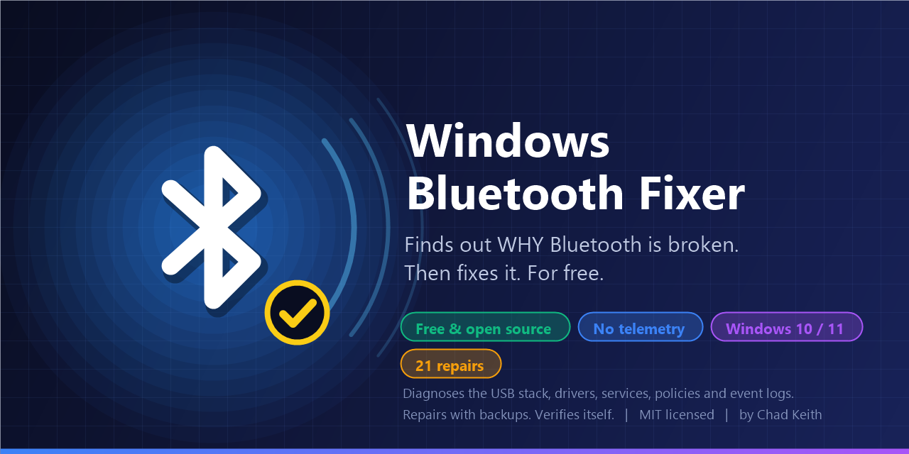
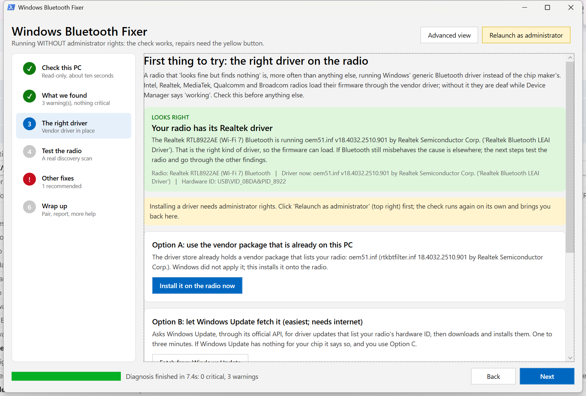
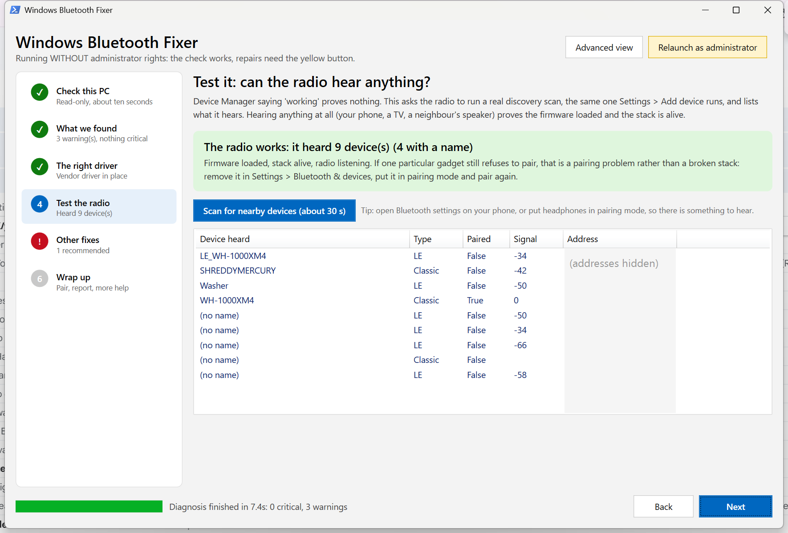

<p align="center">
  
</p>

<h1 align="center">Windows Bluetooth Fixer</h1>

<p align="center">
  <strong>Finds out <em>why</em> Bluetooth is broken on your Windows PC. Then fixes it. For free.</strong>
</p>

<p align="center">
  
  
  
  
  
</p>

---

## 📚 Table of contents

- [🤔 What is this?](#-what-is-this)
- [⚡ Quick start (3 steps)](#-quick-start-3-steps)
- [🧭 The guided flow: what happens when you open it](#-the-guided-flow-what-happens-when-you-open-it)
- [🛡️ "Windows protected your PC" and other first-run gotchas](#️-windows-protected-your-pc-and-other-first-run-gotchas)
- [🖥️ Advanced view](#️-advanced-view)
- [🔧 Fixing things](#-fixing-things)
- [🧰 Every fix, explained](#-every-fix-explained)
- [🔍 Every finding, explained](#-every-finding-explained)
- [⌨️ Command line](#️-command-line)
- [📁 Where it puts files (and how to undo anything)](#-where-it-puts-files-and-how-to-undo-anything)
- [⚠️ Gotchas and things worth knowing](#️-gotchas-and-things-worth-knowing)
- [❓ FAQ](#-faq)
- [🛠️ Development](#️-development)
- [🤝 Contributing](#-contributing)
- [📜 License](#-license)
- [🙏 Credits](#-credits)

---

## 🤔 What is this?

The Windows Bluetooth troubleshooter restarts one service, says "Bluetooth is not available on this device", and shrugs.

This tool does what a support engineer does when they sit down at your PC. It reads the device tree, the driver store, the service registry, the kernel Plug-and-Play event log, the `setupapi` install log, the radio manager, group policies and power settings. Then it tells you, in plain English:

1. **What is wrong** (for example "your USB Root Hub is missing, so the internal Bluetooth radio cannot exist").
2. **What caused it** (for example "at 10:41 PM someone clicked Update driver on the USB Root Hub in Device Manager"), with timestamps pulled from Windows' own logs.
3. **Which repair fixes it**, applies it with a backup, re-checks itself, and offers a reboot with an automatic after-reboot verification when one is needed.
4. **Whether it actually works now**: a real discovery scan that lists what the radio hears. Device Manager saying "working" proves nothing; a radio that hears your phone does.

It was born on a laptop whose owner (that's me) had spent hours "fixing" Bluetooth by stopping services, flipping them between Manual and Automatic, uninstalling things in Device Manager and force-installing the wrong drivers. It found the real cause in eight seconds. Version 1.1 grew up on a desktop whose brand-new Realtek Wi-Fi 7 card showed a perfectly "working" Bluetooth adapter that could not hear a single device: Windows had put its generic driver on it, the vendor driver was two clicks away on the motherboard maker's site, and nothing on the PC said so. Now the tool says so, first, and installs the download for you. Now it's yours.

**No install. No account. No telemetry. No network calls unless you click a button that says it will make one.**

<p align="center">
  
</p>

---

## ⚡ Quick start (3 steps)

> **You need:** Windows 10 (version 1903 or newer) or Windows 11, and an account that can approve the administrator prompt. Nothing else. PowerShell 5.1 is already part of Windows.

1. **Download and unzip.** Click the green **Code** button above > **Download ZIP**, or grab the zip from [Releases](../../releases). Right-click the zip > **Extract All**. Keep the extracted folder together (the `.exe` needs the `src` folder next to it).

2. **Double-click `BluetoothFixer.exe`.** Windows asks "Do you want to allow this app to make changes?" > **Yes**. The window opens and starts checking on its own (about 10 seconds).

   No exe for you? Double-click **`Run-BluetoothFixer.cmd`** instead. Same thing, just a script.

3. **Click Next and do what the screen says.** The guided view walks you through it in order: what it found, the one thing to try first (the right driver on the radio, with a button that installs the file you download), a real scan that proves the radio hears things, then any other fixes, then pairing. Every fix is backed up, logged, and followed by a re-check. A reboot is offered only when genuinely needed, and the tool runs itself once more afterwards to confirm.

That's it for 90% of people. Everything below is for the other 10% and for the curious.

---

## 🧭 The guided flow: what happens when you open it

The left column is the plan; the right side is the current step. Steps turn green when they check out and red when they need you.

| Step | What it does | Why it comes where it does |
|---|---|---|
| **1 Check this PC** | The read-only diagnosis (devices, drivers, services, radio switch, policies, Kernel-PnP log). Nothing is changed. | Everything else is built on it. |
| **2 What we found** | The verdict in one line, your Bluetooth chip, the driver that is on it, the radio switch state, your PC or motherboard model, and the list of problems worst first. | So you know what you are looking at before touching anything. |
| **3 The right driver** | **The first thing to try.** It tells you whether the radio is running the chip maker's driver or Windows' generic one, and if it is the wrong one it gives you three buttons: install a vendor package already on the PC, fetch one from Windows Update, or **install the file you downloaded** from the exact support page it links for your machine (motherboard model for desktops, service tag or model for laptops). It unpacks the download, finds the INF for your hardware ID, checks the signature, installs it and verifies the switch. | Intel, Realtek, MediaTek, Qualcomm and Broadcom radios load their firmware through the vendor driver. With the generic driver they show "working" in Device Manager and hear nothing. This single cause explains more "Bluetooth is broken" reports than everything else combined, and no built-in Windows screen shows it. |
| **4 Test the radio** | A real discovery scan (the same one Settings > Add device runs) listing every device the radio hears, with type, signal and address. Runs by itself when you reach the step; takes 10 to 30 seconds. | It is the only proof that the firmware loaded and the stack is alive. "Heard 11 devices" ends the argument; "heard nothing" sends you back to step 3 or on to step 5. |
| **5 Other fixes** | The remaining fixes the check recommends, pre-ticked, in the order they should run, with one button. Side-effect fixes ask first. | Services, USB stack, power and cleanup matter, but only after the driver is right. |
| **6 Wrap up** | Where things stand, a button straight to Bluetooth settings to pair, the report, the driver pages, and the hardware/BIOS checklist for radios Windows cannot see at all. | So you leave with either working Bluetooth or a report that lets someone help. |

**Advanced view** (button top right) is the full engineer's console described below: every finding with evidence, every device, service, timeline entry, driver link and log line, and the complete 22-fix plan with checkboxes.

<p align="center">
  
</p>

---

## 🛡️ "Windows protected your PC" and other first-run gotchas

**A blue box saying "Windows protected your PC".** That is SmartScreen, and it appears for every program that is not code-signed by a company that paid for a certificate. This one is free, so it isn't. Click **More info**, then **Run anyway**. If you would rather not, double-click `Run-BluetoothFixer.cmd`; it does the same job without the exe.

**"Do you want to allow this app to make changes to your device?"** Yes. Repairing drivers and services needs administrator rights. Diagnosis and the discovery scan do not: if you click **No**, the tool still opens, tells you everything, and shows a yellow **Relaunch as administrator** button for when you're ready.

**Your antivirus complains.** The exe is 7 KB, its entire source is 60 lines in `launcher/BluetoothFixer.Launcher.cs`, and it does nothing but start PowerShell with the GUI script. Every other file is a readable text script. If your antivirus quarantines it, use the `.cmd` launcher.

**It opened a black window for a split second.** Normal. That's the script host starting; the real window follows.

**PowerShell says "running scripts is disabled".** Only happens if you start the scripts by hand. The launchers pass `-ExecutionPolicy Bypass` for you. If you insist on running by hand: `powershell -ExecutionPolicy Bypass -File src\BluetoothFixer.GUI.ps1`.

---

## 🖥️ Advanced view

Click **Advanced view** (top right) for the full console. Click **Guided view** to come back.

### The verdict banner

The colored box in step 2 of the guided view (and the line next to the Diagnose button in Advanced view) is the answer.

| Color | Means |
|---|---|
| 🟥 Red | Something critical is broken. The headline names the worst problem. |
| 🟨 Yellow | No show-stopper, but warnings worth reading. |
| 🟩 Green | Bluetooth looks healthy. If a specific gadget won't pair, that's a pairing problem, not a stack problem (see FAQ). |

Step 2 also shows your PC model (and motherboard, on desktops), Windows build, how many critical/warning findings, whether a radio is present, and which Wi-Fi card you have (combo cards carry the Bluetooth radio, so the Wi-Fi card tells us which Bluetooth chip you should have).

### The tabs

| Tab | What you see | Why you care |
|---|---|---|
| **Findings** | Every problem, sorted worst-first, color-coded. Click one: the right pane shows the explanation, the **evidence** (the raw facts it was based on), and the fixes that address it, with an **Apply these fixes** button. | This is the diagnosis. Read the top red one first. |
| **Fix plan** | All 22 repairs with a checkbox each, the word *Recommended* next to the ones the diagnosis calls for, their risk level, a description, and a **Result** column that fills in as they run. | Pick and choose, or use the buttons: **Select recommended**, **Select all safe**, **Clear**, **Run selected fixes**. |
| **Devices** | Every Bluetooth radio (present or ghost), every USB host controller and root hub, and your Wi-Fi card, with problem code, driver file, version, provider and the raw instance ID. | Shows you what Device Manager shows, plus the bits Device Manager hides. |
| **Services** | 31 Bluetooth and USB services and kernel drivers: current start type vs Windows default, running or not, and a note on what each one is for. Red = disabled, yellow = changed from default. | If you've ever "optimised" services, this is where it shows. |
| **Timeline** | Newest-first list of what happened to Bluetooth and USB devices: configured, started, **failed** (with the kernel status code decoded), **deleted**, **uninstalled by hand in Device Manager**, **Update driver clicked**, removed in Settings. Pulled from the Kernel-PnP event log and `setupapi.dev.log`. | This is how you find out what you (or an update) did, and when. |
| **Drivers and links** | Top: where to get the right driver for *your* chip (Intel page, your PC maker's page by serial number, your motherboard maker's page for your exact board model on desktops, the Windows Update Catalog search for your exact hardware ID). Double-click to open. Bottom: every Bluetooth driver package Windows currently holds in its driver store. | The vendor-download problem, solved without guessing. |
| **Log** | Everything the tool did, with timestamps and the exact commands. Buttons open the log, backup and report folders. | Paste this when asking for help. |

### Buttons along the top of Advanced view

- **Diagnose**: run (or re-run) the read-only diagnosis. Changes nothing.
- **Fix recommended (N)**: run the N fixes the diagnosis recommends, safest first. Reboot, component repair, forgetting pairings and "install from a downloaded package" are never in this list; they're offered separately.
- **Save report**: writes an HTML report (opens in your browser) and a `.json` twin, to `Documents\BluetoothFixer\Reports`. The report now includes the "first thing to try" verdict and the discovery-scan result. Attach the JSON when asking for help.
- **Relaunch as administrator** (always visible top right): only shows when you're not elevated.

---

## 🔧 Fixing things

**The guided path:** step 3 for the driver, step 4 to prove it, step 5 for everything else. Each button tells you what it is about to do.

**The Advanced path:** click **Fix recommended**. Before anything runs:

- If a fix needs a confirmation (USB controller restart, forgetting pairings, reboot), a dialog asks you first and explains the side effect.
- If a fix changes settings, the affected registry keys and every vendor Bluetooth driver package are **exported to a backup folder first** (see [Where it puts files](#-where-it-puts-files-and-how-to-undo-anything)). Untick *Back up registry and drivers first* on the Fix plan tab only if you know why.
- After the fixes, the tool **re-diagnoses** (tick on by default) and shows you a results dialog with one line per fix.
- If any fix says a reboot is needed, the dialog asks **Reboot now?** Yes = Windows restarts in 30 seconds (cancel with `shutdown /a` in a command prompt if you panic) and the tool runs itself once after you log back in to confirm the repair held.

**The manual path:** Fix plan tab, tick what you want, **Run selected fixes**. Or click a finding and **Apply these fixes** for just that problem.

**Order matters, and the tool handles it:** radio on and services first, then USB stack repairs, then drivers, then power, then reboot last.

---

## 🧰 Every fix, explained

Risk levels: **Safe** = read/trigger operations Windows does itself all the time. **Moderate** = changes settings or drivers (always backed up first) or briefly disconnects USB. **Reboot** = restarts Windows.

| Id | Fix | Risk | What it actually does | When the tool recommends it |
|---|---|---|---|---|
| F01 | Rescan hardware | Safe | Same as Device Manager > *Scan for hardware changes* (`pnputil /scan-devices`, with a native fallback on older builds). Re-creates devices that were uninstalled but are physically present: root hubs, radios. | A hub or radio is missing. |
| F02 | Restart USB host controller(s) | Moderate | Disable/enable cycle of the xHCI controller(s) whose root hub is missing or failed. **Every USB device disconnects for 2–3 seconds** (USB keyboard/mouse included; they come straight back). Never removes anything. | Root hub failed and it is not the boot-time buffer-size fault (see F17). |
| F03 | Enable disabled Bluetooth radio | Safe | `pnputil /enable-device` on a radio showing Code 22. | Radio is disabled. |
| F04 | Restart Bluetooth radio device | Safe | Disable/enable the radio. Clears Code 10/43 firmware hangs surprisingly often. | Radio present but not starting. |
| F05 | Remove ghost Bluetooth devices | Safe | Deletes *not-present* radio and paired-device entries so Windows enumerates fresh. Never touches present devices, hubs or controllers. | Ghost radios exist. |
| F06 | Reset Bluetooth services to Windows defaults | Safe | Puts the start type of all 31 services/drivers back to the clean-install value, restores the `bthserv` radio-arrival start trigger if it was lost, then starts the services that should be running (`SystemEventsBroker`, `DeviceAssociationService`, `RmSvc`, `bthserv`, `DeviceInstall`, `DsmSvc`, the per-user `BluetoothUserService`). | Any service disabled, drifted or stopped. |
| F07 | Reinstall the correct radio driver | Moderate | If a vendor package that lists your radio's hardware ID is already in the driver store, installs it onto the device (`UpdateDriverForPlugAndPlayDevices`). Otherwise removes the radio's device entry (and, if a driver from the *wrong* vendor was forced onto it, deletes that package) and rescans so Windows re-matches the best driver. | Generic driver on a vendor radio, wrong-vendor driver, Code 28/31/39. |
| F08 | Fetch driver from Windows Update | Moderate | Uses the Windows Update Agent API to search `Type='Driver'` updates, keeps the ones whose hardware ID matches your radio (or class = Bluetooth), downloads and installs them. **Needs internet.** This is how you get the Intel/Realtek/MediaTek driver without a scavenger hunt. | No vendor package present. |
| F09 | Open vendor download pages | Safe | Opens your browser to: the chip vendor page (Intel has one; Realtek/Qualcomm/MediaTek/Broadcom only ship via PC makers), your PC maker's page (Dell by service tag), and the Windows Update Catalog search for your exact hardware ID. | Whenever a driver might be needed. |
| F10 | Turn radio on / airplane mode off | Safe | Clears the airplane-mode flag and asks the Radio Management API to switch the Bluetooth radio to On. | Radio reports Off, or airplane mode is on. |
| F11 | Clear Bluetooth-blocking policies | Moderate | Removes `AllowBluetooth=0`, `Deny*` device-installation restrictions and similar policy values (backed up as `.reg`), then `gpupdate`. **If your PC is managed by a company (Intune / Group Policy) the policy comes back within an hour and you need IT.** | A blocking policy exists. |
| F12 | Remove third-party Bluetooth class filters | Moderate | Clears `UpperFilters` / `LowerFilters` on the Bluetooth device class. These are leftovers of Toshiba / BlueSoleil / WIDCOMM stacks and block every Bluetooth device from starting. Backed up. **Reboot required.** | Filters present. |
| F13 | Disable power management on the radio | Safe | Sets `EnhancedPowerManagementEnabled=0`, `SelectiveSuspendEnabled=0`, `AllowIdleIrpInD3=0` on the radio and turns off USB selective suspend in the active power plan. Restarts the radio. Fixes "Bluetooth disappears after sleep". | Intel radio with enhanced power management on. |
| F14 | Forget all paired devices | Moderate | Removes every paired-device entry (`BTHENUM`, `BTHLE`). **You pair everything again afterwards.** Fixes corrupted pairing records. | Paired devices have problems. Never auto-run. |
| F15 | Run the Windows troubleshooter | Safe | Launches `msdt /id BluetoothDiagnostic`, or Settings > Troubleshoot on builds where msdt is gone. | On request. |
| F16 | Repair Windows component store | Moderate | `DISM /Online /Cleanup-Image /RestoreHealth` then `sfc /scannow`. Restores missing inbox Bluetooth/USB driver files and INFs. **10–30 minutes, needs internet.** | Inbox files/INFs or service keys missing. Never auto-run. |
| F17 | Reboot now and verify afterwards | Reboot | Registers a one-time run of the tool after logon, then `shutdown /r /t 30`. | Any fix reported *reboot required*; root hub fails with STATUS_INVALID_BUFFER_SIZE. |
| F18 | Hardware / BIOS checklist | Safe | Shows the six steps for a radio Windows cannot see at all: full power drain, BIOS wireless setting, BIOS defaults, driver rollback, reseating the M.2 card, and when to give up and buy a $15 dongle. | No radio ever seen. |
| F19 | Turn off Fast Startup | Safe | `HiberbootEnabled=0`. Every boot becomes a clean driver initialisation. | Informational. |
| F20 | Open Programs and Features | Safe | So you can uninstall third-party Bluetooth stacks. | A third-party stack is installed. |
| F21 | Re-stage inbox USB hub / xHCI driver from the component store | Moderate | When a cumulative update left `ucx01000.sys` (the USB class extension) newer than the installed `usbhub3`/`usbxhci` package, imports the matching Microsoft package from `WinSxS` into the driver store and installs it. Only offered when the mismatch exists **and** the hub failed at boot. | Root hub fails with STATUS_INVALID_BUFFER_SIZE even right after a reboot. |
| F22 | Install vendor driver from a downloaded package | Moderate | You point it at the Bluetooth driver you downloaded from your PC or motherboard maker: a `.zip`, `.exe`, `.cab`, `.inf` or a folder. It unpacks it (nested archives too: motherboard makers ship a zip holding a 7-Zip self-extractor holding the INF), finds the INF that lists your radio's hardware ID, prefers the Bluetooth-class x64 one with a valid catalog signature, runs `pnputil /add-driver /install`, forces the device over if Windows kept the old driver, and verifies which driver the radio runs afterwards. Backed up first. If the download is an installer 7-Zip cannot open, it says so and tells you to run it yourself. Needs 7-Zip for `.exe` packages; `.zip`/`.cab`/folders work without it. | Generic Microsoft driver on a vendor radio, no driver, or wrong-vendor driver. The guided view's step 3 is this fix with a file picker. |

Things it will **never** do, no matter what you tick: uninstall a USB root hub, a host controller, or any PCI/ACPI device; delete an inbox Microsoft driver package; touch anything without writing it to the log.

---

## 🔍 Every finding, explained

Short version below; the long version with the exact fix logic is in [`docs/FIELD-GUIDE.md`](docs/FIELD-GUIDE.md).

**Environment**
- `ENV-ADMIN` Not elevated. Diagnosis works; fixes need the yellow button.
- `ENV-REBOOT` Windows has a pending restart from an update or driver change. Fixes may not show until then.
- `ENV-AIRPLANE` Airplane mode is on. Every radio is off.

**USB stack** (the part no other tool checks; on laptops the Bluetooth radio is an internal USB device)
- `USB-NOROOTHUB` A host controller is running but has no USB Root Hub under it. Textbook result of uninstalling "USB Root Hub" in Device Manager.
- `USB-HUBPROBLEM` A root hub exists but failed. With status `0xC0000206` the tool says "reboot first" and skips useless controller restarts.
- `USB-DRVMISMATCH` Hub/controller driver older than the USB class extension (update left the driver store behind).
- `USB-NOCTRL` / `USB-CTRL-*` Controller missing or failed: chipset driver or BIOS.

**Radio**
- `RADIO-NONE-USB` No radio because the USB stack is broken. Fix USB first.
- `RADIO-NONE-GHOST` Windows remembers a radio (last seen / last removed timestamps shown) but it is not there now.
- `RADIO-NONE` Never seen a radio. BIOS setting, power drain, dead module, or the PC has none.
- `RADIO-DISABLED-*`, `RADIO-NODRIVER-*`, `RADIO-DRVLOAD-*`, `RADIO-SVCDISABLED-*`, `RADIO-FAILSTART-*`, `RADIO-REBOOT-*`, `RADIO-PROBLEM-*` The radio's Device Manager problem code, decoded, with the kernel status behind it.
- `RADIO-MULTI` Two radios (dongle + internal) fighting. Disable one, never uninstall.
- `RADIO-GHOSTS` Old radio entries; harmless, cleanable.
- `RM-OFF` / `RM-DISABLED` / `RM-UNKNOWN` / `RM-NOBT` What the Radio Management service (the on/off toggle) thinks.

**Driver**
- `DRV-GENERIC-*` The inbox "Generic Bluetooth Adapter" driver (`bth.inf`) is on an Intel / Realtek / MediaTek / Qualcomm / Broadcom radio. Those need vendor firmware; with the generic driver they show up in Device Manager as "working", the toggle may even appear, and they never hear anything. This is the guided view's step 3 and the first thing to fix.
- `DRV-WRONGVENDOR-*` A driver from a different chip vendor was forced on ("Let me pick" with "Show compatible hardware" unticked).
- `DRV-NEWER-*` A newer vendor package is already in the store (informational).
- `STORE-FILES` / `STORE-INFS` Inbox `bthport.sys`, `bthusb.sys`, `bth.inf`, `usbhub3.inf` ... missing.
- `STORE-NOVENDOR-*` No vendor package for your radio in the store.
- `FILTER-BT` / `FILTER-USB` Class filter drivers from old third-party software.

**Discovery test** (step 4 of the guided view, `-Scan` on the command line)
- Not a finding but a verdict: *heard N devices* means firmware loaded and stack alive; *heard nothing* or *timed out* means the radio is deaf, which with a generic driver confirms `DRV-GENERIC-*`, and with a vendor driver points at hardware, power state or a stuck Bluetooth Support Service.

**Services**
- `SVC-DISABLED` Something in the baseline is Disabled. This alone kills Bluetooth.
- `SVC-DEVIATE` Manual/Automatic drift. Usually harmless, always a fingerprint of manual tinkering.
- `SVC-MISSING` / `SVC-IMAGE` Service key or driver file gone.
- `SVC-TRIGGER` `bthserv` lost its start triggers, so it never starts by itself.
- `SVC-BTHSERV-STOPPED` / `SVC-DAS` Should be running when a radio is present.

**Policy, software, power, paired devices, history**
- `POL-*` Bluetooth or device-install policies. `AllowBluetooth=0` is a hard off switch.
- `STACK-*` Toshiba / BlueSoleil / WIDCOMM / "Bluetooth Driver Installer" detected.
- `SOFT-WRONGVENDOR-*` Bluetooth software from a different chip vendor than your radio is installed (the Intel package on a Realtek PC, say). Harmless, but it is the wrong download and it will never drive your radio.
- `PWR-EPM-*` Intel radio with enhanced USB power management (vanishes after sleep). `PWR-FASTSTARTUP` Fast Startup on.
- `CHILD-PROBLEMS` Paired devices failing while the radio is fine.
- `HIST-UNINSTALL` Devices uninstalled, or "Update driver" clicked, by hand in Device Manager, with timestamps.
- `HIST-FAILED` Recent driver start failures decoded.

---

## ⌨️ Command line

For scripting, remote help, or people who just like text. Same engine, same fixes.

```bat
Run-BluetoothFixer-CLI.cmd
```
opens an elevated console, diagnoses, lists the recommended fixes, asks before applying, then writes a report.

Direct use:

```powershell
# diagnose only (works without admin); prints the "first thing to try" block
powershell -ExecutionPolicy Bypass -File src\BluetoothFixer.CLI.ps1

# diagnose, then run the discovery test: does the radio hear anything? (works without admin)
powershell -ExecutionPolicy Bypass -File src\BluetoothFixer.CLI.ps1 -Scan

# install the Bluetooth driver you downloaded from your PC/motherboard maker, re-check, then scan (needs admin)
powershell -ExecutionPolicy Bypass -File src\BluetoothFixer.CLI.ps1 -DriverPackage "%USERPROFILE%\Downloads\mb_driver_bluetooth.zip" -Yes

# diagnose, then apply the recommended fixes (asks first)
powershell -ExecutionPolicy Bypass -File src\BluetoothFixer.CLI.ps1 -Fix Recommended

# only the Safe-rated recommended fixes, no questions asked
powershell -ExecutionPolicy Bypass -File src\BluetoothFixer.CLI.ps1 -Fix Safe -Yes

# specific fixes by id
powershell -ExecutionPolicy Bypass -File src\BluetoothFixer.CLI.ps1 -Fix F06,F04 -Yes

# also write the HTML + JSON report and open it
powershell -ExecutionPolicy Bypass -File src\BluetoothFixer.CLI.ps1 -Report

# machine-readable findings on stdout (for support scripts)
powershell -ExecutionPolicy Bypass -File src\BluetoothFixer.CLI.ps1 -Json

# list all fix ids
powershell -ExecutionPolicy Bypass -File src\BluetoothFixer.CLI.ps1 -ListFixes
```

| Parameter | Meaning |
|---|---|
| `-Fix <ids>` | `Recommended`, `Safe`, or a comma-separated list like `F01,F06`. |
| `-DriverPackage <path>` | Runs F22 with that `.zip` / `.exe` / `.cab` / `.inf` or folder, re-checks, then scans. |
| `-Scan` | After the diagnosis (and after any fixes), run the discovery test and list what the radio heard. |
| `-Yes` | No confirmation prompts. Required for `F17` (reboot) in the CLI. |
| `-Report` | Write HTML + JSON to `Documents\BluetoothFixer\Reports` and open the HTML. |
| `-Json` | Print the diagnosis as JSON instead of the colored text. |
| `-Days <n>` | How far back to read the event logs for the timeline (default 30). |
| `-ListFixes` | Print the fix catalog and exit. |

The engine is a normal PowerShell module, so you can also `Import-Module src\BluetoothFixer.psm1` and call `Invoke-BFDiagnosis`, `Get-BFRecommendedFixes`, `Invoke-BFFix -FixId F06`, `Test-BFDiscovery`, `Install-BFDriverPackage -Path .\bt.zip -DryRun`, `Export-BFReport` yourself. `(Invoke-BFDiagnosis).FirstStep` is the guided "first thing to try" as an object.

---

## 📁 Where it puts files (and how to undo anything)

| What | Where |
|---|---|
| Logs (every run, every command) | `C:\ProgramData\BluetoothFixer\Logs\` |
| Backups (before any settings change) | `C:\ProgramData\BluetoothFixer\Backups\<date-time>\` |
| Unpacked driver downloads (F22) | `C:\ProgramData\BluetoothFixer\Packages\<date-time>\` (or `%TEMP%\BluetoothFixer\Packages` for a dry run without admin) |
| Reports (HTML + JSON) | `Documents\BluetoothFixer\Reports\` |
| GUI crash details, if the window itself ever errors | `%TEMP%\BluetoothFixer-GUI-errors.log` |

**To undo a settings change:** open the backup folder for that run, double-click the `.reg` file for the key you want back, accept the prompt. Vendor driver packages exported there can be re-added with `pnputil /add-driver "<folder>\*.inf" /install` from an administrator prompt. Each backup folder has a `README.txt` saying exactly this.

The tool writes nowhere else (a driver you install through F22 goes into the Windows driver store, like any driver; `pnputil /delete-driver oemNN.inf /uninstall` from an administrator prompt removes it, and the number is in the log). Delete those folders and it has never been here.

---

## ⚠️ Gotchas and things worth knowing

- **Don't "Update driver" or "Uninstall" a USB Root Hub. Ever.** On laptops the Bluetooth radio, the webcam, the fingerprint reader and the card reader all hang off that hub. Windows usually recovers with a reboot, but the failure mode is exactly the one this tool was written for.
- **Intel, Realtek, MediaTek, Qualcomm and Broadcom radios do not work with the generic Microsoft driver.** They show up in Device Manager looking fine, the toggle may even appear, and they never hear anything. Only CSR-based dongles are happy with the inbox driver. The tool tells you which case you're in, first, and the discovery scan proves it either way.
- **Realtek, Qualcomm, MediaTek and Broadcom don't publish Bluetooth drivers to the public.** Your PC maker's support page (or, on a desktop, your motherboard maker's page for your exact board, which the tool links directly for Gigabyte and MSI and searches for the rest) or the Windows Update Catalog search are the legitimate sources. F09 opens them; F22 installs what you download; F08 asks Windows Update directly, which often has nothing for brand-new chips.
- **Downloading the wrong vendor's package is easy and does nothing.** The Intel Bluetooth installer on a Realtek PC installs fine and changes nothing. The `SOFT-WRONGVENDOR` finding catches that, and step 3 names the vendor you actually need.
- **The USB controller restart (F02) disconnects every USB device for a couple of seconds.** A USB keyboard/mouse comes straight back. An external drive being written to could lose data, so close file copies first. The tool asks before doing it.
- **The reboot (F17) really does restart in 30 seconds.** Save your work when you click Yes. `shutdown /a` in a command prompt cancels it.
- **Company-managed PCs:** if F11 removes a policy and it comes back, Intune or Group Policy is re-applying it. Ask IT; the tool cannot win that fight and shouldn't.
- **Two radios (USB dongle + internal):** Windows only uses one at a time. Disable the one you don't want in Device Manager. Don't uninstall it.
- **Bluetooth disappears after sleep:** that is the enhanced power management setting on Intel radios, or Fast Startup. F13 and F19 exist for that; they are informational until you have that symptom.
- **Windows 10 older than 1903:** `pnputil /scan-devices` doesn't exist there; the tool falls back to the native API. Older than 1809 is untested and unsupported.
- **ARM64 Windows (Snapdragon laptops):** Bluetooth there is usually a UART/ACPI device, not USB. The tool sees it under Radio, but the USB-stack checks won't apply. Untested; reports welcome.
- **Documents on OneDrive:** if your Documents folder is redirected to OneDrive, the reports go there too. That's Windows' choice, not the tool's.
- **Version strings lie.** If you compare `Get-Item ...\drivers\UsbHub3.sys | % VersionInfo` with the driver store copy you may see different versions for identical files: Windows reads the string from a language resource file. The tool reads the binary's fixed version block instead.
- **The report JSON contains your PC model, computer name, user name and serial number** (they're what make the PC-maker link work). Blank them in Notepad before posting it publicly if you care.

---

## ❓ FAQ

**It says everything is healthy but my headphones won't connect.**
Run step 4 (or `-Scan`). If the radio hears other devices, the stack is fine and the pairing is the problem. Settings > Bluetooth & devices > the device > Remove, put the headphones in pairing mode (usually hold the power button 5–7 s until the light flashes), pair again. If *every* device fails to pair, F14 (forget all pairings) resets the pairing store.

**It says no radio was ever seen. Am I sure my PC even has Bluetooth?**
Look at the Wi-Fi name in the banner. Intel AX/BE, Realtek RTL8xxx, MediaTek MT79xx and Qualcomm QCNFA/FastConnect cards all include Bluetooth. If your Wi-Fi is one of those and no radio shows, follow F18 (BIOS setting, power drain, reseat). Desktops with wired-only motherboards genuinely have none; a USB dongle fixes that for $15.

**Why does it want a reboot when it already "fixed" it?**
Some drivers only reload at boot, and one specific failure (`STATUS_INVALID_BUFFER_SIZE` on a root hub) cannot be cleared while Windows is running. The tool tells you which case applies in the results dialog.

**Will this break anything?**
Diagnosis is read-only. Fixes are the same operations Device Manager, `services.msc` and Windows Update perform, done in the right order with a backup first. The dangerous operations (uninstalling hubs/controllers, deleting inbox drivers) are hard-blocked in the code, not just avoided.

**Can I run it on someone else's PC remotely?**
Yes: `src\BluetoothFixer.CLI.ps1 -Json` gives you the whole diagnosis as text, and `-Fix ... -Yes` applies fixes without prompts. Works over any remote shell that gives you an elevated PowerShell.

**Does it need internet?**
No. Only F08 (Windows Update fetch), F16 (DISM repair) and F09 (opening web pages) use the network, and only when you run them.

**Where's the catch?**
There isn't one. Read the license.

---

## 🛠️ Development

```
Windows-Bluetooth-Fixer/
├── BluetoothFixer.exe            7 KB elevating launcher (built from launcher/, committed so nobody needs a compiler)
├── Run-BluetoothFixer.cmd        GUI launcher without the exe
├── Run-BluetoothFixer-CLI.cmd    console launcher
├── src/
│   ├── BluetoothFixer.psm1       the engine: diagnosis, 22 fixes, discovery test, package installer, backup, report
│   ├── BluetoothFixer.Data.psd1  knowledge base: USB vendor IDs, Intel/Realtek PIDs, PC-maker and motherboard URLs,
│   │                             service baseline, problem codes, NTSTATUS decoder, protected devices
│   ├── BluetoothFixer.GUI.ps1    WPF window: guided six-step view + Advanced view; engine runs in a background runspace
│   └── BluetoothFixer.CLI.ps1    console front end / JSON output (-Scan, -DriverPackage)
├── launcher/                     C# source + manifest + build script for the exe (uses the csc.exe inside Windows)
├── tools/make-banner.ps1         draws assets/banner.png with GDI+
├── docs/FIELD-GUIDE.md           every finding and fix, in depth
├── docs/PUBLISHING.md            maintainer checklist
└── assets/                       banner and screenshots
```

**Requirements to hack on it:** a text editor. Everything runs on Windows PowerShell 5.1 with no modules. Test with:

```powershell
Import-Module .\src\BluetoothFixer.psm1 -Force
$d = Invoke-BFDiagnosis
$d.Findings | Format-Table Severity, Id, Title
$d.FirstStep | Format-List Situation, Headline, DriverText, HardwareId
Get-BFRecommendedFixes -Diagnosis $d
Test-BFDiscovery -TimeoutSec 45 | Select-Object Count, Named, DurationSec
Install-BFDriverPackage -Path .\some-download.zip -DryRun   # unpacks and picks the INF, installs nothing
```

**Rebuild the exe** (only if you change `launcher/BluetoothFixer.Launcher.cs`): `powershell -ExecutionPolicy Bypass -File launcher\build-launcher.ps1`. It compiles with the .NET Framework compiler that ships in every Windows install, so there is nothing to download.

**Two PowerShell rules learned the hard way:** variable names are case-insensitive (`$w` and `$W` are the same variable, and a local `$f` inside a scriptblock will happily shadow your `$F` list), and never name a parameter `$Args`.

---

## 🤝 Contributing

- **Bluetooth still broken after the tool?** Open an issue with the JSON report attached (Save report > `Documents\BluetoothFixer\Reports\*.json`). Blank `ComputerName`, `UserName` and `Serial` if you like. The timeline and device inventory in there are what make a fix possible.
- **New chip IDs, PC-maker URL patterns, failure signatures:** all live in `src/BluetoothFixer.Data.psd1`. Pull requests welcome; please cite where a PID/chip mapping came from.
- **New checks or fixes:** add a finding in `Invoke-BFAnalysis` and a case in `Invoke-BFFix`, register it in `Get-BFFixCatalog`, give it a rank in `Get-BFRecommendedFixes`, document it in `docs/FIELD-GUIDE.md` and this README. If it belongs in the guided flow, teach `Get-BFDriverSituation` (step 3) or the step-5 list in the GUI about it.
- **Motherboard download-page patterns:** `OemSupport[].BoardUrl` in the data file, `{model}` = board product with spaces turned into hyphens. Gigabyte and MSI are in; ASUS and ASRock fall back to a search until someone confirms a stable pattern.

---

## 📜 License

MIT. Give it to anyone who's bluetooth doesn't work and doesn't want to spend the API calls to Fable 5.1 on Ultracode to diagnose, fix, and write their own solution to the problem. I did. Because if it's worth doing, it's worth over-doing, damn it. $free.00. Gratis. Pro-bono. On the house. Your money is no good here. Because giving someone back time they've already mentally spent troubleshooting something the windows troubleshooter should be good at, but sucks a fat one at, or the thought of that, makes me feel good. This is more for me, so even though it's for anyone and everyone, this is really all selfish and here to make me feel better about myself because I helped you, and that's not important for you to know, but it's important to ME that YOU know that, you know what I mean?

Full text in [`LICENSE`](LICENSE).

---

## 🙏 Credits

- Built by **Chad Keith** ([@chchchadzilla](https://github.com/chchchadzilla)) with Claude as co-founder, on a Dell G15 whose Bluetooth was very, very broken, and a Gigabyte B850 desktop whose Realtek RTL8922AE radio was very, very deaf.
- Chip ID mappings cross-checked against the Linux `btusb` tables and public USB ID databases.
- Microsoft, for shipping `pnputil`, the Windows Update Agent API and a Kernel-PnP event log detailed enough to make this possible.
